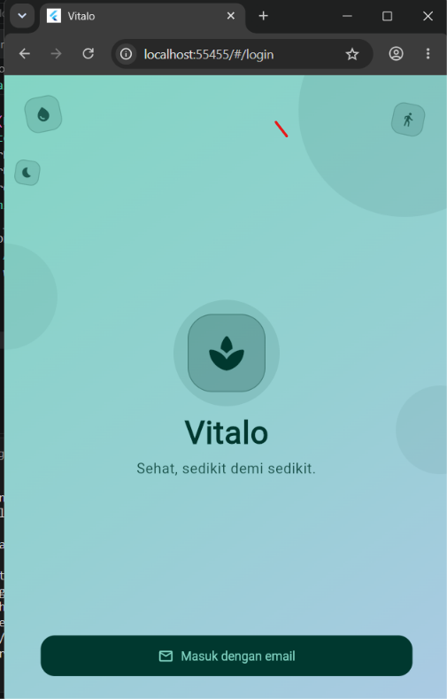
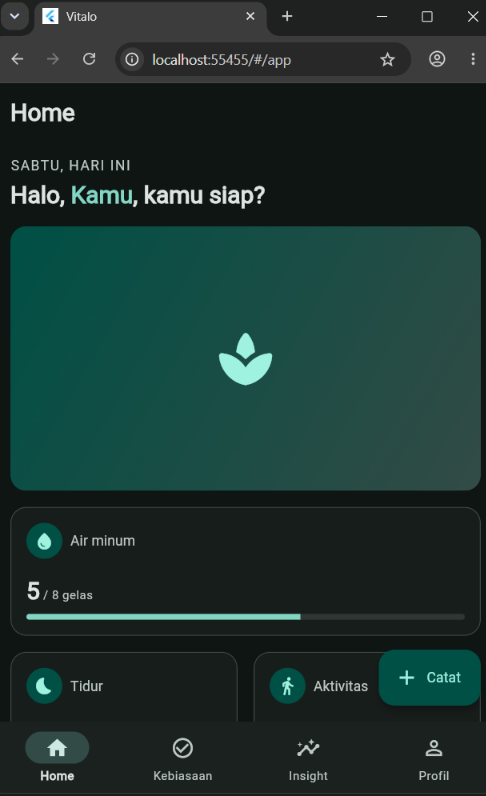
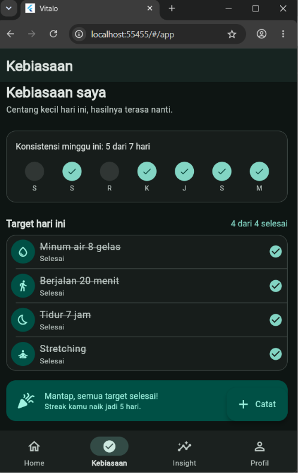
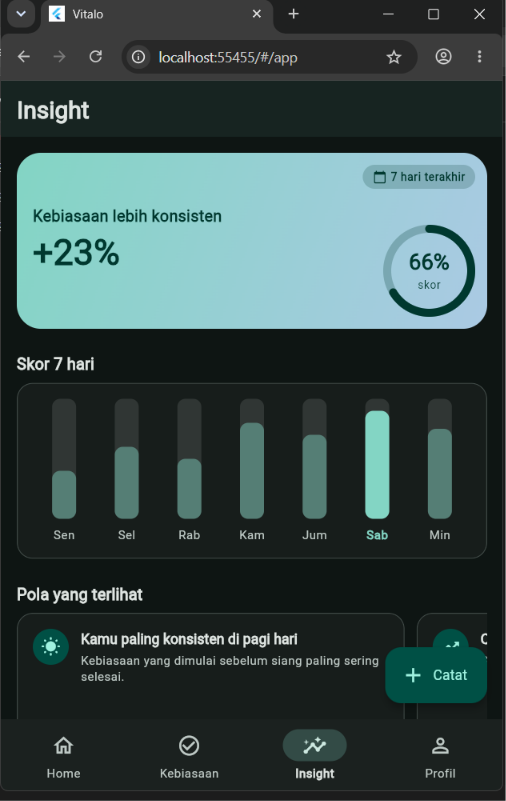
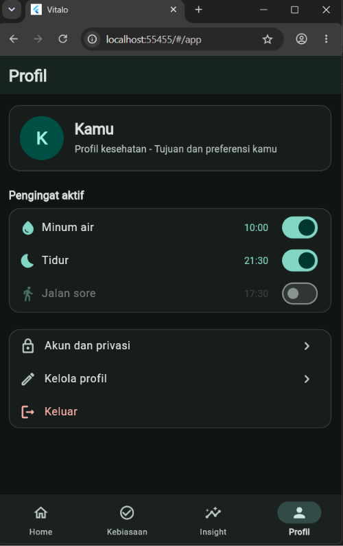

# Vitalo

> **Sehat, sedikit demi sedikit.**

Vitalo adalah aplikasi wellness harian untuk pekerja kantoran dan mahasiswa usia 18-35 yang sibuk. Aplikasi ini membantu mencatat tiga hal sederhana: **tidur**, **air minum**, dan **aktivitas/gerak**, dengan prinsip desain yang ringkas, sekali tap, dan tidak memutus fokus pengguna.

Proyek ini dibuat sebagai tugas kuliah dan **hanya frontend**: tidak ada backend, database, API, atau login sungguhan. Semua data berasal dari data dummy.


## Tampilan Aplikasi

| 01 Splash & Login | 02 Home Dashboard
| :---: | :---: | :---: |
|  |  |

| 03 Pelacak Kebiasaan | 04 Insight Progres | 05 Pengingat & Profil |
| :---: | :---: | :---: |
|  |  |  |

## Fitur per Layar

1. **Splash & Login**: logo muncul dengan fade + scale halus, disusul tagline. Tombol **Masuk dengan email** membuka bottom sheet; email apa pun diterima (mode demo), lalu masuk ke aplikasi dengan transisi fade. Ketuk layar saat splash untuk melewati animasi.
2. **Home Dashboard**: sapaan dan hari ini, ilustrasi header, serta tiga kartu ringkasan (air, tidur, langkah) dengan angka yang menghitung naik satu kali. Ada tombol pintasan **Tambah catatan**.
3. **Tambah Catatan**: tiga tab cepat **Tidur | Air | Aktivitas**. Tidur memakai stepper 15 menit dan pilihan kualitas, Air memakai tombol quick-add **+1 gelas**, Aktivitas memakai pilihan jenis dan stepper durasi. Simpan menutup layar dan menampilkan SnackBar "Catatan tersimpan".
4. **Pelacak Kebiasaan**: kartu konsistensi 7 hari, daftar target harian yang bisa dicentang (hitungan "X dari Y selesai" ikut berubah), dan banner streak yang berubah menjadi ucapan selamat saat semua target selesai.
5. **Insight Progres**: kartu hero dengan cincin progres, bar chart skor 7 hari, carousel "Pola yang terlihat" dengan indikator titik, dan grid 6 badge (terbuka/terkunci).
6. **Pengingat & Profil**: kartu profil, daftar pengingat dengan switch dan pemilih waktu (24 jam), menu akun, serta konfirmasi keluar. Tata letak menyesuaikan ukuran layar: 1 kolom di HP portrait, 2 kolom di layar lebar atau landscape.

Navigasi utama memakai `NavigationBar` 4 tab (Home, Kebiasaan, Insight, Profil) dan tombol **Catat** (FAB) yang otomatis tersembunyi di tab Profil.

## Prinsip Desain dan Animasi

- **Satu bahasa visual**: semua warna berasal dari `Theme` (`ColorScheme` seed hijau-teal `#1F9D8A` + `HabitColors`), jarak dari `AppSpacing`, dan durasi dari `AppMotion`.
- **Animasi punya tujuan**: feedback sentuhan, transisi konteks, atau menarik perhatian ke perubahan data. Durasi 200-500 ms dengan satu curve (`easeOutCubic`).
- **Tidak membingungkan**: tidak ada animasi berulang selamanya, tidak menghalangi interaksi, dan maksimal satu fokus gerak pada satu waktu.
- **Aksesibel**: menghormati pengaturan sistem *hapus/kurangi animasi* (`disableAnimations`), target sentuh minimal 48 dp, dan label semantics pada komponen utama.
- **Mode terang dan gelap** mengikuti pengaturan sistem.

## Teknologi

| Komponen | Keterangan |
| --- | --- |
| Framework | Flutter (stable), Dart null-safety |
| UI | Material 3 (`useMaterial3: true`) |
| State | `StatefulWidget` + `setState` (lokal, tanpa penyimpanan) |
| Data | `DummyData` (statis) |
| Package tambahan | Tidak ada (hanya SDK Flutter) |

## Struktur Proyek

```text
lib/
├── main.dart                 # MaterialApp, tema, route awal
├── app/
│   ├── routes.dart           # AppRoutes: /login, /app, /add
│   └── app_shell.dart        # Scaffold + NavigationBar + FAB
├── core/
│   └── responsive.dart       # Breakpoints, ResponsiveBuilder, MaxWidthBox
├── data/
│   └── dummy_data.dart       # Model Habit + DummyData
├── theme/
│   ├── app_theme.dart        # AppTheme.light/dark + HabitColors
│   ├── app_spacing.dart      # AppSpacing, AppRadius
│   ├── app_motion.dart       # AppMotion (durasi + curve)
│   └── theme_preview_screen.dart
├── widgets/                  # Widget reusable
│   ├── stat_card.dart
│   ├── habit_tile.dart
│   ├── app_avatar.dart
│   └── section_title.dart
└── features/
    ├── login/login_screen.dart
    ├── home/home_screen.dart
    ├── add_entry/add_entry_screen.dart
    ├── habits/habit_tracker_screen.dart
    ├── insight/insight_screen.dart
    └── profile/profile_screen.dart
```

Alur aplikasi: `LoginScreen` → `AppShell` (4 tab) → tombol **Catat** → `AddEntryScreen`.

## Cara Menjalankan

Prasyarat: [Flutter SDK](https://docs.flutter.dev/get-started/install) versi stable terbaru (Dart 3.13.4 atau lebih baru, sesuai `pubspec.yaml`).

```bash
git clone https://github.com/hanusstep497-lab/VITALO.git
cd VITALO
flutter pub get
flutter run
```

Opsi lain:

```bash
flutter run -d chrome                              # jalankan di browser
flutter run -t lib/theme/theme_preview_screen.dart # pratinjau tema (palet, tipografi, komponen)
flutter analyze                                    # cek kualitas kode
```

Tips uji tampilan: coba ukuran 360x640, 412x915, landscape, tablet/jendela web yang di-resize, mode gelap, dan pengaturan sistem "hapus animasi".

## Pembagian Tugas Tim

Tugas dibagi menjadi 9 task, dengan satu file/layar per task sehingga penggabungan di Git minim konflik. Setiap commit memakai prefix `[T#]`.

| Task | Materi | Cakupan | File utama | Penanggung jawab |
| --- | --- | --- | --- | --- |
| T1 | Flutter Fundamentals | Penerapan `Scaffold`, navigasi shell | `main.dart`, `app/routes.dart`, `app/app_shell.dart` | Anggota 1 (Ketua) |
| T2 | Vibe Coding Fundamentals | Splash & Login | `features/login/login_screen.dart` | Anggota 2 |
| T3a | UI Components I | Text, Icon, Image, RichText | `features/home/home_screen.dart` | Anggota 2 |
| T3b | UI Components II | CircleAvatar & reusable widget | `widgets/*.dart` | Anggota 3 |
| T4 | Material Design & UI Dasar | Material 3: warna, tipografi, spacing | `theme/*.dart` | Anggota 1 (Ketua) |
| T5 | Layout Dasar | Single-child layout | `features/add_entry/add_entry_screen.dart` | Anggota 3 |
| T6a | Multi-Child Layout I | Row, Column, ListView | `features/habits/habit_tracker_screen.dart` | Anggota 1 (Ketua) |
| T6b | Multi-Child Layout II | GridView, Stack, Expanded, Carousel | `features/insight/insight_screen.dart` | Anggota 2 |
| T7 | Responsive & Adaptive UI | Breakpoint, LayoutBuilder, orientasi | `core/responsive.dart`, `features/profile/profile_screen.dart` | Anggota 3 |

### Anggota

| Peran | Nama | NIM |
| --- | --- | --- |
| Anggota 1 (Ketua, pemilik repo) | Stephanus Hartanto | 241112044 |
| Anggota 2 | Gylbert Mars Antonius | 241111802 |
| Anggota 3 | Nicholas Lungnata | 241111664 |

Daftar kontribusi per anggota dapat dilihat dengan:

```bash
git log --pretty=format:"%an | %s" --grep="\[T"
```

## Responsive

| Kelas ukuran | Lebar | Perilaku `ProfileScreen` |
| --- | --- | --- |
| Compact | < 600 | 1 kolom (2 kolom jika landscape dan lebar ≥ 480) |
| Medium | 600 - 840 | 2 kolom, konten dibatasi lebar maksimum |
| Expanded | > 840 | 2 kolom, konten dibatasi lebar maksimum |

## Pengembangan Selanjutnya

- Adaptasi `AppShell` menjadi `NavigationRail` pada lebar ≥ 840 (tahap 2 task T7).
- Menyimpan catatan secara lokal agar data Home, Kebiasaan, dan Insight ikut berubah setelah mencatat.
- Menambahkan ilustrasi header Home (`assets/images/t3a_home_header.png`); saat ini memakai fallback gradient + ikon.

