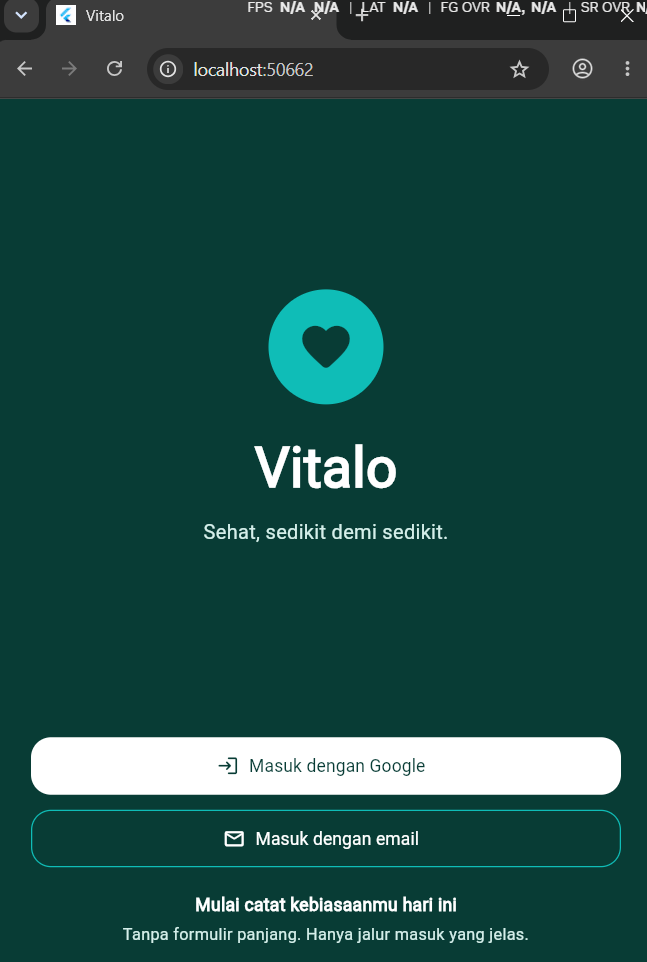
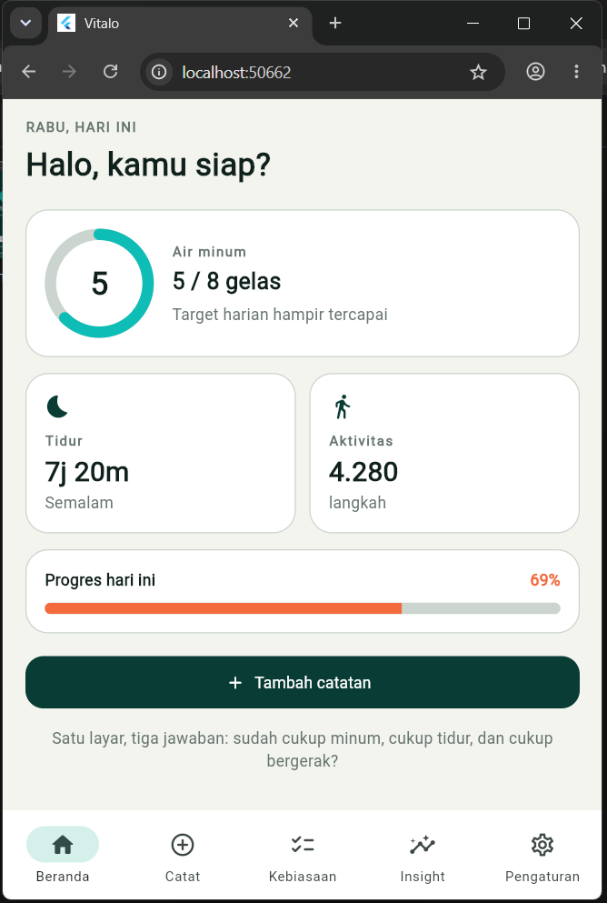
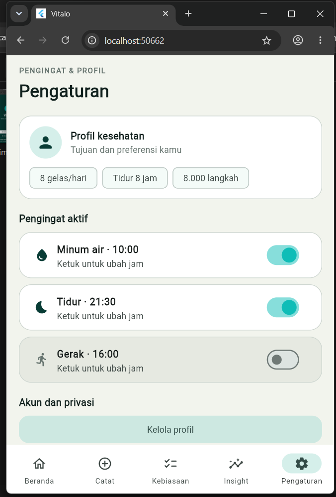
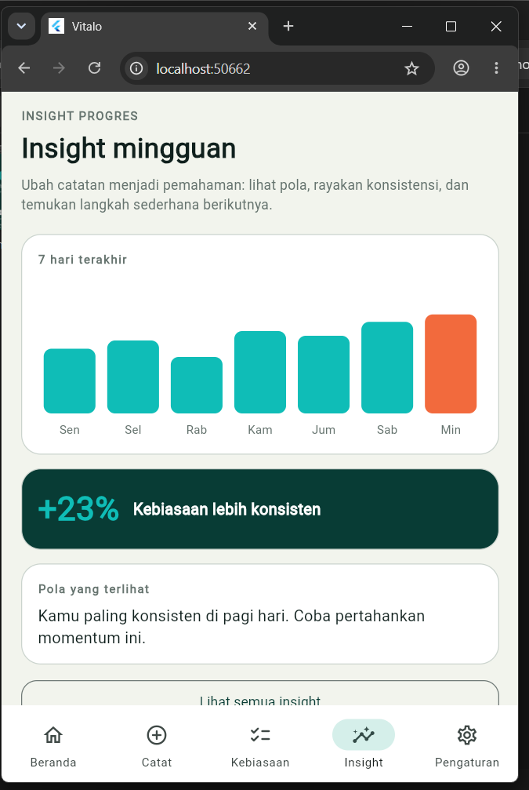
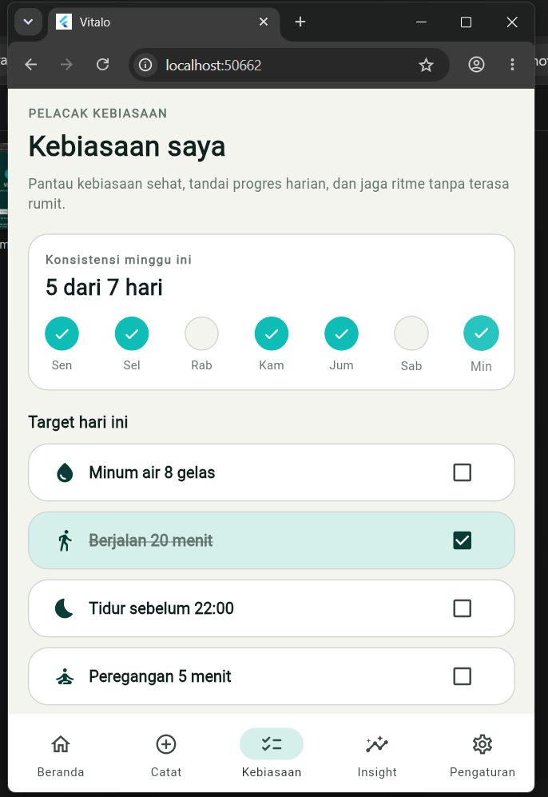
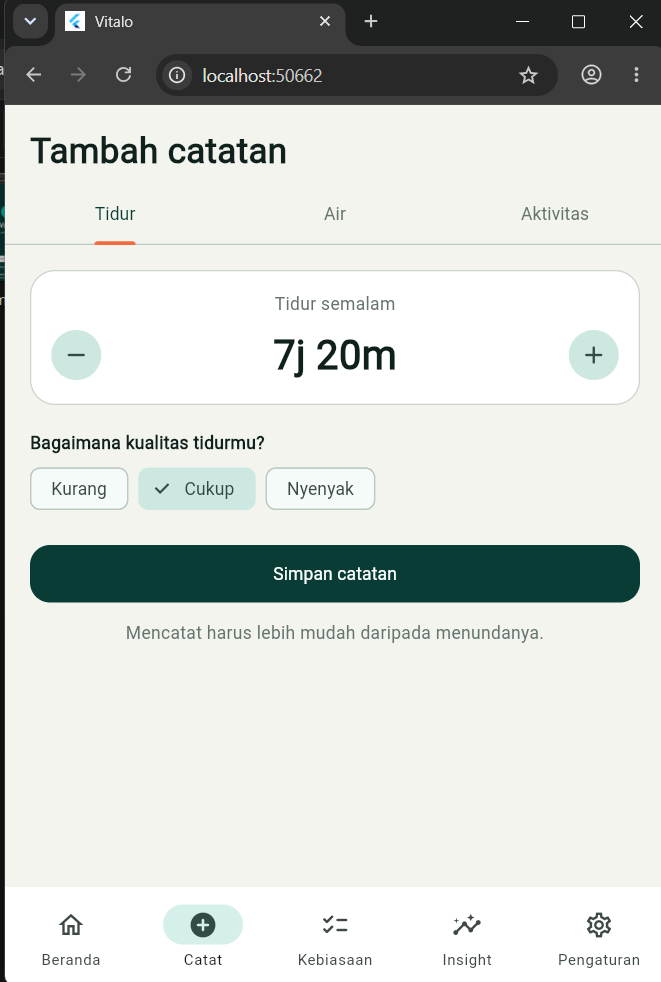

# Vitalo — Kebiasaan sehat, setiap hari

Aplikasi wellness harian berbasis **Flutter** untuk mencatat **tidur, air minum, dan gerak** dalam satu ritme sederhana.
Proyek ini dibuat berdasarkan proposal *Vitalo* (tugas mata kuliah).

> **Status: Iterasi 2 — penyempurnaan UI/UX dengan animasi.** Data masih **dummy** (disimpan di memori, hilang saat aplikasi ditutup). Backend, login sungguhan, dan notifikasi asli belum diimplementasikan.

## Riwayat Iterasi

| Iterasi | Fokus | Hasil |
| --- | --- | --- |
| 1 | Membuat 6 halaman sesuai proposal | Navigasi, state management, data dummy |
| 2 | **Animasi & penyempurnaan UI/UX** | Animasi di semua layar, haptic feedback, dialog centang, confetti + badge |

## Tampilan Aplikasi

Screenshot diambil dari emulator/perangkat dan disimpan di `docs/screenshots/`.

| 01 Splash & Login | 02 Home Dashboard | 03 Tambah Catatan |
| :---: | :---: | :---: |
|  |  |  |

| 04 Pelacak Kebiasaan | 05 Insight Progres | 06 Pengingat & Profil |
| :---: | :---: | :---: |
|  |  |  |

<!-- Setelah rekaman layar dibuat, hapus tanda komentar di bawah ini dan simpan file sebagai docs/screenshots/demo.gif
### Demo Animasi

-->

## Animasi pada Iterasi 2

Semua animasi memakai API bawaan Flutter (**tanpa package tambahan**) dan berdurasi di bawah ~1 detik agar tidak menghalangi pengguna.

| Layar | Animasi | Teknik |
| --- | --- | --- |
| Splash & Login | Logo membesar (efek memantul) → nama → tagline → tombol naik dari bawah | `AnimationController` + `Interval` |
| Semua layar | Transisi fade antar halaman; perpindahan tab fade + geser tipis | `PageRouteBuilder`, `AnimatedSwitcher` |
| Home | Kartu muncul berurutan, cincin air terisi, angka *count-up*, bar progres bergerak halus | `Staggered`, `TweenAnimationBuilder` |
| Tambah Catatan | Tombol quick-add memantul + getaran, angka air berganti dengan efek *pop*, centang animasi saat simpan | `AnimatedScale`, `AnimatedSwitcher`, `CustomPainter` |
| Tambah Catatan | **Confetti + badge "Hidrasi Harian"** saat target air 8 gelas tercapai | `CustomPainter` (partikel) |
| Pelacak Kebiasaan | Lingkaran hari "pop" berurutan, kartu berubah warna + coretan saat dicentang, ikon api streak berdenyut | `Staggered`, `AnimatedContainer`, `Pulse` |
| Insight | Batang grafik tumbuh dari bawah berurutan, angka `+23%` *count-up*, daftar insight masuk berurutan | `TweenAnimationBuilder` |
| Pengingat & Profil | Kartu pengingat berubah warna saat dimatikan/dinyalakan | `AnimatedContainer` |

Komponen animasi yang dapat dipakai ulang ada di `lib/widgets/common.dart` (`ProgressRing`, `CountUpText`, `Staggered`, `Pulse`, `fadeRoute`) dan `lib/widgets/feedback.dart` (`showSuccessCheck`, `showCelebration`).

## Daftar Halaman (6 layar)

| No | Layar | File |
| --- | --- | --- |
| 1 | Splash & Login | `lib/screens/splash_login_screen.dart` |
| 2 | Home Dashboard | `lib/screens/home_screen.dart` |
| 3 | Tambah Catatan | `lib/screens/add_entry_screen.dart` |
| 4 | Pelacak Kebiasaan | `lib/screens/habit_tracker_screen.dart` |
| 5 | Insight Progres | `lib/screens/insight_screen.dart` |
| 6 | Pengingat & Profil | `lib/screens/settings_screen.dart` |

## Status Pengerjaan

| Fitur | Status |
| --- | --- |
| 6 halaman UI sesuai proposal | Selesai |
| Navigasi bottom navigation + transisi | Selesai |
| State management (ChangeNotifier + InheritedNotifier) | Selesai |
| Animasi UI/UX di seluruh layar | Selesai (iterasi 2) |
| Haptic feedback, dialog centang, confetti + badge | Selesai (iterasi 2) |
| Penyimpanan permanen / backend | Belum |
| Login Google/email sungguhan | Belum |
| Notifikasi pengingat sungguhan | Belum |
| Insight dari data nyata, streak otomatis | Belum |
| Dark mode | Belum |

## Struktur Proyek

```
lib/
├── main.dart                  # entry point + AppScope
├── theme.dart                 # palet warna & tema (sesuai proposal)
├── utils.dart                 # format angka, durasi, jam
├── state/app_state.dart       # AppState (data dummy, badge) + AppScope
├── widgets/
│   ├── common.dart            # VCard, ProgressRing, CountUpText, Staggered, Pulse, fadeRoute
│   └── feedback.dart          # dialog centang & perayaan confetti
└── screens/                   # 6 layar + main_shell (bottom navigation)
test/widget_test.dart          # tes alur login -> home dan pindah tab
```

## Cara Menjalankan

```bash
git clone <url-repo>
cd vitalo
flutter create . --project-name vitalo --platforms=android,ios,web   # hanya jika folder android/ ios/ belum ada
flutter pub get
flutter run
```

Menjalankan tes: `flutter test` — Analisis kode: `flutter analyze`

---

# Cara Push Iterasi 2 ke Proyek GitHub yang Sudah Ada

Panduan ini untuk memasukkan hasil iterasi 2 ke repo yang **sudah berisi iterasi 1** (milik Ketua Kelompok), tanpa membuat repo baru.

## 0. Prasyarat

| Kebutuhan | Cara cek / siapkan |
| --- | --- |
| Git terpasang | `git --version` |
| Punya akses push ke repo Ketua | Ketua menambahkan Anda di **Settings → Collaborators** (lihat Skenario C bila belum) |
| Login GitHub dari terminal | HTTPS memakai *Personal Access Token* (bukan password), atau `gh auth login` |
| Nama branch utama | `git branch --show-current` (biasanya `main`, bisa juga `master`) |

## 1. Siapkan folder repo

**Skenario A — repo sudah pernah di-clone di komputer Anda**

```bash
cd vitalo
git status                 # pastikan bersih (tidak ada perubahan yang belum di-commit)
git pull origin main       # ambil perubahan terbaru dari teman satu kelompok
```

**Skenario B — belum ada di komputer ini**

```bash
git clone https://github.com/<username-ketua>/<nama-repo>.git
cd <nama-repo>
```

**Skenario C — Anda bukan collaborator**

Pilih salah satu:
1. Minta Ketua menambahkan akun GitHub Anda sebagai collaborator, lalu ikuti Skenario A/B.
2. **Fork** repo Ketua (tombol *Fork* di GitHub), clone fork Anda, kerjakan langkah 2–6, lalu buka **Pull Request** ke repo Ketua (langkah 7).

## 2. Buat branch khusus iterasi 2 (disarankan)

```bash
git checkout -b iterasi-2-animasi
```

Dengan branch terpisah, iterasi 1 di `main` tetap aman dan perubahan iterasi 2 mudah ditinjau.

## 3. Timpa file dengan hasil iterasi 2

1. Ekstrak `vitalo_flutter_iterasi2.zip`. Hasilnya folder `vitalo/`.
2. Salin **seluruh isi** folder `vitalo/` ke folder repo, pilih **Replace/Timpa**.

```bash
# Mac / Linux (jalankan dari dalam folder repo; sesuaikan path ekstraksi)
rsync -av ~/Downloads/vitalo/ ./
```
```powershell
# Windows PowerShell (jalankan dari dalam folder repo)
Copy-Item -Path "$HOME\Downloads\vitalo\*" -Destination . -Recurse -Force
```

Catatan penting:
- **Jangan menghapus** `android/`, `ios/`, `web/`, atau `docs/screenshots/` milik Anda. ZIP tidak berisi folder tersebut sehingga screenshot iterasi 1 tetap aman.
- File yang berubah: `lib/` (semua layar, `widgets/`, `state/`), `test/widget_test.dart`, dan `README.md`. File baru: `lib/widgets/feedback.dart`.

## 4. Uji sebelum push

```bash
flutter pub get
flutter analyze
flutter test
flutter run
```

Pastikan tidak ada error, login masuk ke Home, dan animasi tampil di emulator.

## 5. Perbarui screenshot (untuk README)

Ambil ulang 6 screenshot dari versi iterasi 2 dan **timpa** file di `docs/screenshots/` dengan nama yang sama:

`01_login.png`, `02_home.png`, `03_tambah_catatan.png`, `04_kebiasaan.png`, `05_insight.png`, `06_pengaturan.png`

Opsional: rekam layar emulator, ubah ke GIF, simpan sebagai `docs/screenshots/demo.gif`, lalu hapus tanda komentar `<!-- -->` pada bagian *Demo Animasi* di README.

## 6. Commit

```bash
git status                 # periksa file apa saja yang berubah
git add .
git commit -m "feat: iterasi 2 - animasi dan penyempurnaan UI/UX"
```

Bisa juga dipecah supaya riwayat lebih rapi:

```bash
git add lib/widgets lib/state
git commit -m "feat: tambah komponen animasi (Staggered, CountUpText, Pulse, confetti)"
git add lib/screens
git commit -m "feat: terapkan animasi pada 6 layar"
git add README.md docs test
git commit -m "docs: perbarui README, screenshot, dan test iterasi 2"
```

## 7. Push

```bash
git push -u origin iterasi-2-animasi
```

Lalu gabungkan ke `main` dengan **salah satu** cara:

| Cara | Langkah |
| --- | --- |
| **Pull Request** (disarankan) | Buka repo di GitHub → klik **Compare & pull request** → beri judul "Iterasi 2: animasi UI/UX" → **Merge pull request** |
| Langsung dari terminal | `git checkout main` → `git pull origin main` → `git merge iterasi-2-animasi` → `git push origin main` |

Opsional, beri penanda versi:

```bash
git tag -a v0.2.0 -m "Iterasi 2: animasi UI/UX"
git push origin v0.2.0
```

## 8. Kumpulkan link untuk pengumpulan tugas

| Yang dikumpulkan | Contoh |
| --- | --- |
| Link repo GitHub | `https://github.com/<username-ketua>/<nama-repo>` |
| Link progres iterasi 2 | link Pull Request, atau `https://github.com/<username-ketua>/<nama-repo>/tree/iterasi-2-animasi` |
| File Logbook | sesuai format dari dosen |

## Masalah yang sering muncul

| Gejala | Penyebab | Solusi |
| --- | --- | --- |
| `rejected ... non-fast-forward` | Ada commit baru dari teman di GitHub | `git pull --rebase origin main`, selesaikan konflik bila ada, lalu push lagi |
| `403` / `Permission denied` | Belum punya akses atau token salah | Minta akses collaborator, atau pakai Fork + Pull Request; buat *Personal Access Token* baru |
| `Authentication failed` | GitHub tidak menerima password biasa | Pakai Personal Access Token atau `gh auth login` |
| `error: src refspec main does not match` | Branch utama bernama `master` | Ganti `main` dengan `master` pada perintah |
| Konflik di `README.md` | README juga diedit orang lain | Buka file, pilih isi yang benar, hapus penanda `<<<<<<<`, lalu `git add README.md` dan `git rebase --continue` (atau `git commit`) |
| Screenshot tidak muncul di GitHub | Nama file berbeda atau belum di-push | Samakan nama file dengan README, pastikan sudah `git add docs/` |
| Folder `build/` ikut ter-commit | `.gitignore` tidak terpakai | Pastikan `.gitignore` dari ZIP ada; jalankan `git rm -r --cached build` |
